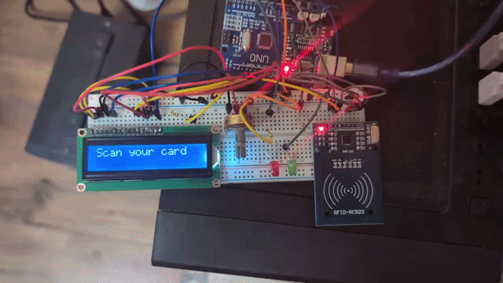
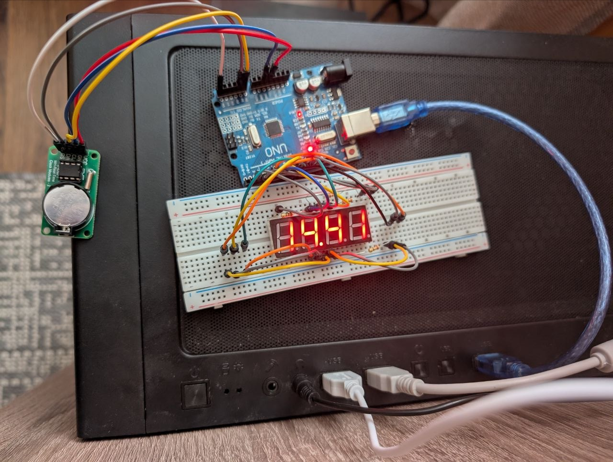

# My Arduino projects

Collection of fun projects with Arduino.

## Hardware
- Board: Arduino UNO

## Projects
* Mini RFID + LCD security system
* Shift register LED bar with potentiometer
* Shift register Joystick RGB Controller
* 4 digit 7 segment display with DS1302 clock module

## Mini RFID + LCD security system
```
./sketch_sep03c/sketch_sep03c.ino
```
Working example 



## Shift register LED bar with potentiometer
```
sketch_aug27a/sketch_aug27a.ino
```
Circuit design


Working example 


## Shift register Joystick RGB Controller
```
./sketch_aug28a/sketch_aug28a.ino
```

Working example 


## 4 digit 7 segment display with DS1302 clock module
```
./sketch_aug28b/sketch_aug28b.ino
```

Working example 


