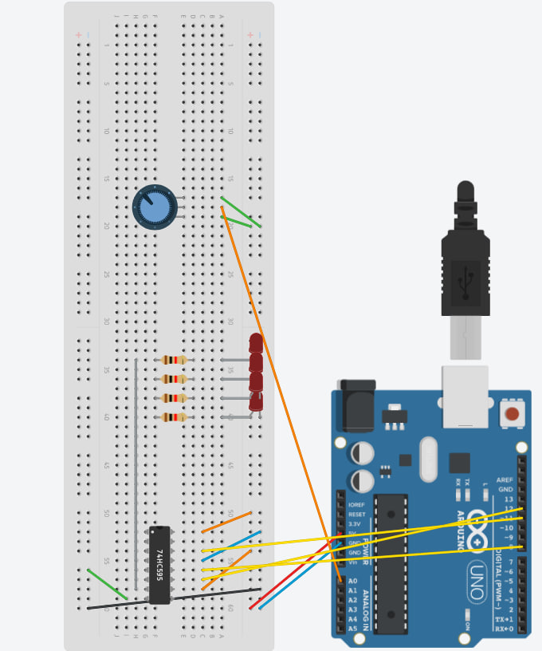
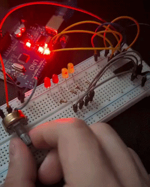
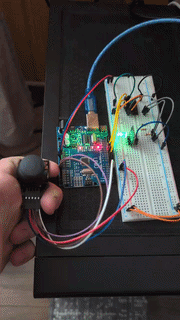

# My Arduino projects

Collection of fun projects with Arduino.

## Hardware
- Board: Arduino UNO

## Projects
* Shift register LED bar with potentiometer

## Shift register LED bar with potentiometer
```
sketch_aug27a/sketch_aug27a.ino
```
Circuit design



Working example 



## Shift register Joystick RGB Controller
```
./sketch_aug28a/sketch_aug28a.ino
```

Working example 


